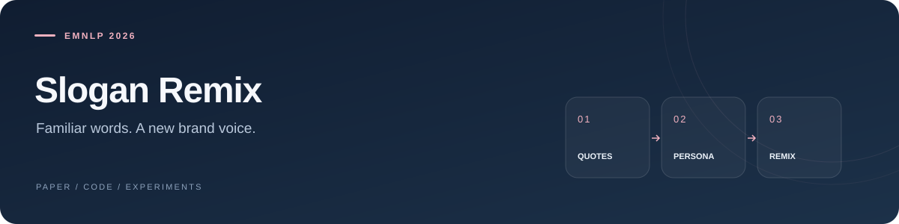

## Recontextualizing Famous Quotes for Brand Slogan Generation

**Ziao Yang**, Zizhang Chen, Lei Zhang, and Hongfu Liu  
*EMNLP 2026 · Main Conference*

**[Read the PDF](https://arxiv.org/pdf/2602.06049)** &nbsp; / &nbsp; [Paper](https://arxiv.org/abs/2602.06049) &nbsp; / &nbsp; [Preference survey](https://github.com/yangziao56/slogan-survey-web)

### A familiar phrase. A different possibility.

Match a quote to a persona, unpack its structure, replace the vocabulary, and remix it into a brand slogan.

### Three ways to remix

**All in one prompt**  
[`1stage_multi_pass.py`](1stage_multi_pass.py) combines the steps in a single-pass prompt with multiple samples.

**Find the quote, then transform it**  
[`2stage.py`](2stage.py) separates quote selection from slogan remixing. [Launch script →](run_2stage.sh)

**Give each step its own stage**  
[`scripts/4stage.py`](scripts/4stage.py) makes quote matching, structure breakdown, vocabulary replacement, and remix generation explicit. [Launch script →](run_4stage.sh)

---

<details>
<summary><strong>Open the workshop · setup, datasets & fine-tuning</strong></summary>

```bash
git clone https://github.com/yangziao56/qwen-lora-finetune.git
cd qwen-lora-finetune
pip install -r requirements.txt
```

Choose a workflow above and configure its model, brand, persona, and output settings.

- **Datasets:** [`dataset_slogans.csv`](dataset_slogans.csv), [`dataset_slogans-v2.csv`](dataset_slogans-v2.csv)
- **Fine-tuning:** [`finetune_lora.py`](scripts/finetune_lora.py), [`deepspeed_finetune_lora.py`](scripts/deepspeed_finetune_lora.py)
- **Human evaluation:** the companion [survey repository](https://github.com/yangziao56/slogan-survey-web) contains the slogan preference web interface.

</details>

<details>
<summary><strong>Citation</strong></summary>

```bibtex
@misc{yang2026sloganremix,
  title = {Recontextualizing Famous Quotes for Brand Slogan Generation},
  author = {Yang, Ziao and Chen, Zizhang and Zhang, Lei and Liu, Hongfu},
  year = {2026},
  eprint = {2602.06049},
  archivePrefix = {arXiv},
  url = {https://arxiv.org/abs/2602.06049}
}
```

</details>
